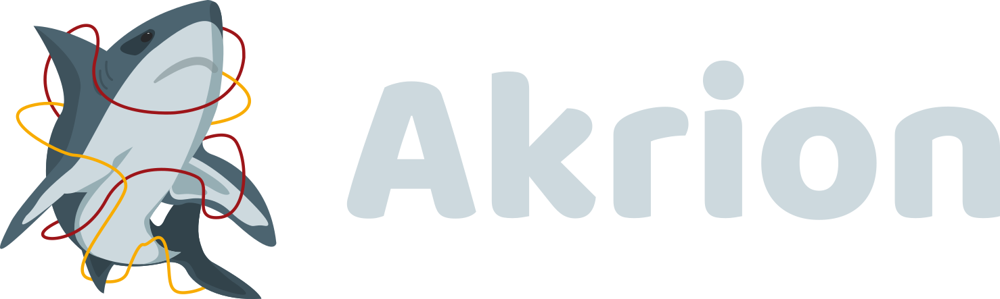

<p align="center">
  
</p>
<p align="center"> 
  
  
  
</p>

<p align="center">
  <strong>Akrion</strong> — легковесная защита для вашего сервера!
</p>

> [!WARNING]
> Don't take the project too seriously, vibe coding project! xD

## 📋 Возможности

- 🔍 **Анализ трафика**: Захват и анализ TCP пакетов с использованием GoPacket
- 💾 **Оптимизация памяти**: Использование SnapLen для захвата только заголовков пакетов (96 байт)
- 🛡️ **Обнаружение атак**: Автоматическое обнаружение сканирования портов
- 📊 **Веб-дашборд**: Современный интерфейс с реал-тайм обновлениями через WebSocket
- 💻 **Мониторинг системы**: Отслеживание использования CPU и RAM
- 🗄️ **База данных**: Хранение статистики в SQLite через GORM

## 🛠️ Технологии

- **Язык**: Go 1.21+
- **Анализ трафика**: [GoPacket](https://github.com/google/gopacket)
- **HTTP-фреймворк**: [Gin](https://github.com/gin-gonic/gin)
- **WebSocket**: [Gorilla WebSocket](https://github.com/gorilla/websocket)
- **База данных**: [GORM](https://github.com/go-gorm/gorm) + SQLite
- **Системный мониторинг**: [gopsutil](https://github.com/shirou/gopsutil)

## 💿 Установка

### 📦 Требования

- Go 1.21 или выше
- Права root для захвата пакетов
- libpcap (обычно устанавливается через системный пакетный менеджер)

### 🗂️ Установка зависимостей

```bash
# Ubuntu/Debian
sudo apt-get install libpcap-dev
```

### 💾 Сборка и запуск

```bash
# Клонирование репозитория
git clone <repository-url>
cd Akrion

# Установка зависимостей Go
go mod download
go mod tidy
```

## ⚙️ Использование

### Запуск сервера

Программа должна запускаться с правами root для захвата сетевых пакетов.

#### Способ 1: Запуск без сборки (рекомендуется для разработки)

```bash
sudo go run cmd/server/main.go -interface eth0 -port 1337 -db akrion.db
```

#### Способ 2: Сборка и запуск бинарника

```bash
# Сборка
go build -o akrion cmd/server/main.go

# Запуск
sudo ./akrion -interface eth0 -port 1337 -db akrion.db
```

### Параметры командной строки

- `-interface` (обязательно): Имя сетевого интерфейса для мониторинга (например, `eth0`, `enp0s3`)
- `-port` (опционально): Порт для веб-сервера (по умолчанию: `1337`)
- `-db` (опционально): Путь к файлу базы данных SQLite (по умолчанию: `akrion.db`)

### Примеры

```bash
# Запуск на интерфейсе eth0 с портом 1337
sudo go run cmd/server/main.go -interface eth0

# Запуск на интерфейсе enp0s3 с портом 3000 и кастомной БД
sudo go run cmd/server/main.go -interface enp0s3 -port 3000 -db /var/lib/akrion/data.db
```

## 📊 Веб-интерфейс

После запуска сервера откройте браузер и перейдите по адресу:

```
http://localhost:1337
```

### Вкладки дашборда

1. **Главная**: Краткая статистика трафика и последние пакеты
2. **Detect**: Обнаруженные аномалии и сканирования портов
3. **Honeypot**: Активность honeypot (если настроена)
4. **CPU/RAM**: Системные метрики в реальном времени

## 🔌 API Endpoints

### REST API

- `GET /api/traffic` — Получить последние записи трафика
- `GET /api/detections` — Получить обнаружения
- `GET /api/honeypot` — Получить активность honeypot
- `GET /api/system` — Получить историю системных метрик
- `GET /api/system/current` — Получить текущие системные метрики
- `GET /api/summary` — Получить сводку статистики
- `GET /api/stats` — Получить статистику пакетов в реальном времени

### WebSocket

- `WS /ws` — WebSocket соединение для реал-тайм обновлений

## 📐 Архитектура

```
akrion/
├── cmd/
│   └── server/          # Основной веб-сервер
├── internal/
│   ├── capture/         # Захват пакетов
│   ├── config/          # Конфигурация
│   ├── detection/       # Обнаружение атак
│   └── server/          # HTTP/WebSocket handlers
├── pkg/
│   ├── models/          # Модели данных (GORM)
│   ├── monitor/         # Системный мониторинг
│   └── websocket/       # WebSocket хаб
├── web/
│   ├── static/          # Статические файлы (CSS, JS)
│   └── templates/       # HTML шаблоны
└── go.mod               # Зависимости Go
```

## ⚡ Оптимизации

- **SnapLen**: Захват только первых 96 байт каждого пакета для экономии памяти
- **Батчинг**: Пакетная запись статистики в БД (каждые 5 секунд или при накоплении 100 записей)
- **Горутины**: Параллельная обработка пакетов и веб-запросов
- **In-memory кеш**: Быстрый доступ к статистике без обращения к БД

## 🗄️ База данных

База данных SQLite автоматически создаётся при первом запуске. Структура включает:

- `traffic_stats` — Статистика трафика
- `detections` — Обнаруженные аномалии
- `honeypot_activities` — Активность honeypot
- `system_metrics` — Системные метрики

## 📝 Рекомендация для владельцев серверов

У меня возникла идея дать название концепции, которая, как я полагаю, возможно, уже существует и, возможно, имеет своё устоявшееся название, но я хочу назвать её «Unarmed Container/Server».<br><br>
Концепция «Unarmed Container/Server» подразумевает минималистский подход к развертыванию и управлению инфраструктурой. Основная идея заключается в том, чтобы включать в контейнер или сервер только те компоненты и инструменты, которые действительно необходимы для выполнения конкретных задач. Это помогает снизить количество потенциальных уязвимостей, уменьшить размер образа и упростить управление.

[Подробнее на Habr](https://habr.com/ru/companies/oleg-bunin/articles/799773/) [RU]

<details>
<summary>📚 Полезные инструменты</summary>

[PEASS-ng](https://github.com/peass-ng/PEASS-ng) — Privilege Escalation Awesome Scripts SUITE. Поможет обнаружить ошибки в настройках.
</details>

## 🔧 Разработка

### Запуск в режиме разработки

```bash
# Установка зависимостей
go mod download

# Обычный запуск без сборки
sudo go run cmd/server/main.go -interface eth0
```

## 📄 Лицензия

См. файл [LICENSE](LICENSE)

## 📌 Благодарности

- [defence](https://github.com/s0i37/defence)
